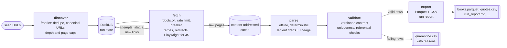
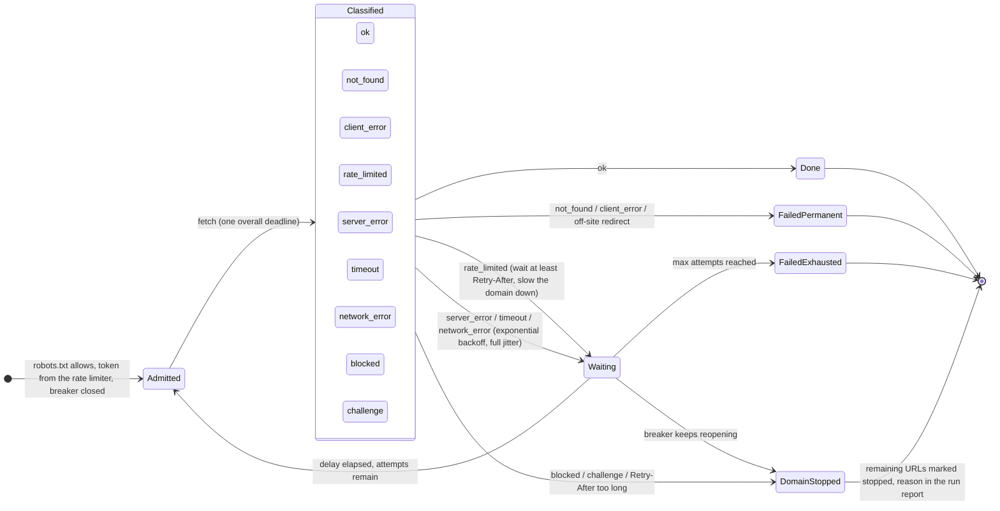

# resilient-scraping-pipeline

[](https://github.com/TTB8/resilient-scraping-pipeline/actions/workflows/ci.yml)


[](LICENSE)

**A polite, resumable, reproducible web data pipeline in Python.** Five re-runnable stages turn
public web pages into typed, validated Parquet and CSV files that analysts can trust, with lineage
on every row and a run report that says exactly what happened.

```
discover → fetch → parse → validate → export
```

It targets only the two sites built for scraping practice, [books.toscrape.com](https://books.toscrape.com)
and [quotes.toscrape.com](https://quotes.toscrape.com) (including the JavaScript-rendered
[/js](https://quotes.toscrape.com/js/) variant). The engineering is what a company needs when it
collects public web data at scale.

## Why this exists

Most scrapers are one script. Each failure below is the default in that script, and each has a
specific answer here.

| The one-off script... | This pipeline... | Where |
|---|---|---|
| **re-downloads everything** whenever a selector changes or the run crashes | stores raw pages in a content-addressed cache; `parse` is offline, so a new field means re-running `parse`, never re-fetching. A crashed `fetch` resumes where it stopped | [ADR 0001](docs/decisions/0001-separate-fetch-from-parse.md), [0002](docs/decisions/0002-content-addressed-cache.md), [0008](docs/decisions/0008-duckdb-run-state.md) |
| **silently ships bad data**: a broken selector becomes blanks, or the row just disappears | validates every row against a versioned contract. Failing rows go to a quarantine file with the field, the rule and the value. Nothing is dropped, and the run fails loudly | [ADR 0004](docs/decisions/0004-contracts-and-quarantine.md) |
| **can't reproduce its output**: two runs, two files, no way to tell what changed | the same cache gives **byte-identical** outputs, and the run id on every row is derived from the inputs | [ADR 0003](docs/decisions/0003-deterministic-outputs.md) |
| **breaks when the site pushes back**: hammers through 429s, or reaches for proxies and stealth plugins | classifies every response, honours `Retry-After`, backs off with jitter, trips a per-domain circuit breaker and **stops the domain** with a clear reason. It detects blocks and never evades them | [ADR 0005](docs/decisions/0005-detection-not-evasion.md) |
| **is rude by default**: no robots.txt, a fake browser User-Agent, unbounded concurrency | obeys robots.txt (RFC 9309), sends an honest User-Agent with a contact URL, defaults to one request per second per domain, and enforces hard ceilings in code | [ADR 0006](docs/decisions/0006-politeness-defaults.md) |
| **wanders off**: follows redirects anywhere, including internal addresses | confines the crawl to its site. Every redirect hop is robots-checked and rate-limited, and an off-site one is refused | [ADR 0009](docs/decisions/0009-site-confinement.md) |

## The pipeline



Each stage is its own command and is safe to re-run. `discover` is insert-only, `fetch` only
fetches what is missing, and `parse`, `validate` and `export` are pure functions of the cache.
`pipeline run` runs all five in order.

## How a response is handled

Every response is classified first. Then the reaction depends only on the class, so the policy
for each kind of failure lives in one place
([`core/classify.py`](src/scraping_pipeline/core/classify.py),
[`core/retry.py`](src/scraping_pipeline/core/retry.py),
[`core/circuit.py`](src/scraping_pipeline/core/circuit.py)).



The circuit breaker is per domain. It opens after consecutive transient failures, allows exactly
one probe after a cooldown, and stops the domain if it keeps reopening. Other domains carry on.

## Quickstart

Requires Python 3.12 and [uv](https://docs.astral.sh/uv/).

```bash
uv sync
make demo                                       # offline: runs against a local server, no internet
uv run pipeline run --site books --max-depth 1  # live: about 70 pages at 1 request per second
```

`make demo` runs the books site cleanly (exit code 0), then the quotes site while the local server
pushes back. `/page/2/` first answers `429` with `Retry-After: 1`: the pipeline slows the domain
down and fetches it on a retry more than a second later. Then an author page answers `403` with a
block page: the domain is stopped and nothing more is sent. The report names the block, and the
valid rows (6 quotes, 2 authors) are still delivered, the rest quarantined with reasons (exit
code 3). The demo prints the server's timeline and checks this story itself: it exits non-zero
if any part of it does not hold, so CI catches a regression.

Outputs go to `./data/output/<site>/`. Each stage can also be run on its own:

```bash
uv run pipeline discover --site quotes
uv run pipeline fetch    --site quotes      # Ctrl-C at any point, then run it again: it resumes
uv run pipeline parse    --site quotes      # offline
uv run pipeline validate --site quotes
uv run pipeline export   --site quotes
uv run pipeline status   --site quotes      # frontier counts, stopped domains, recent runs
```

For the JavaScript-rendered site: `make browsers`, then `uv run pipeline run --site quotes-js`.

**Docker:**

```bash
docker build -t resilient-scraping-pipeline .                      # add --build-arg WITH_BROWSER=1 for quotes-js
docker run --rm -v "$PWD/data:/data" resilient-scraping-pipeline run --site books --max-depth 1
```

**Exit codes** are part of the interface, so a scheduler can react without reading logs:

| Code | Meaning |
|---|---|
| 0 | everything ran and the data passed validation |
| 1 | validation failed: valid rows are delivered, failing rows are in `quarantine.csv` |
| 2 | usage error: a bad option or setting, a missing stage input, or the state database is in use |
| 3 | a domain was stopped (blocked, a challenge, rate-limited beyond limits). The rest still ran |
| 130 | interrupted. Progress is saved; run the same command again to resume |

## A real run report

From the committed [example output](examples/): `pipeline run --site quotes` against the live
site, the whole site.

```markdown
## Pages

- Discovered: 60
- Fetched: 60
- Failed: 0
- HTTP requests (robots.txt and redirect hops included): 111

## Domains stopped

None.

## Parse

- Item pages fetched: 60
- Item pages with records: 60 (coverage 100.00%)
- Records parsed: 150

## Validation

- Contract: `quotes/1.0.0`
- Verdict: **PASS**: 0 of 150 rows quarantined, within max rate 0.0
```

111 requests for 60 pages, because every author link on that site redirects, and each hop waits
for the rate limiter like any request. The first live run of this site quarantined all 100 quotes
as `unknown_author`: those redirects also switch from https to http, and the confinement rule
refused them. The contract caught the bug instead of shipping quotes without authors.
[examples/README.md](examples/README.md) tells the story, and the fix is in the history.

## What every row carries

| Column | Why |
|---|---|
| `source_url` | the page the row came from |
| `content_sha256` | the exact bytes it was parsed from (look the page up in the cache) |
| `fetch_run_id` | which crawl fetched that page |
| `parse_run_id` | derived from (those pages, parser version, contract version): same inputs, same id |
| `parser_version`, `contract_version` | which code and which rules produced it |

## Testing

```bash
make test        # the full suite in parallel, with coverage
make test-fast   # the quick subset the commit hook runs
```

About 1,100 tests, and none of them touches the network. They run against saved pages and a local
fixture server that can be told to time out, drip bytes, answer 429 with `Retry-After`, return 5xx,
redirect, or serve block and challenge pages.

- **Unit tests for every core rule.** The core is pure (no I/O, no clock, no randomness; [ADR 0007](docs/decisions/0007-pure-core-injected-time.md)), at 99% line and branch coverage. CI fails below 90% on the core and on the stages and CLI.
- **Property-based tests (Hypothesis)** on parsers (never raise, round-trip, deterministic), the backoff policy (within the cap, never under `Retry-After`), the circuit breaker (never two half-open probes), the rate limiter (never more than `burst + rate × elapsed`), URL canonicalization (idempotent), the cache manifest (order-independent) and validation (no row lost).
- **Virtual time.** The scheduler runs on an injected clock, so a ten-minute backoff scenario takes milliseconds, and a stuck scheduler raises `DeadlockError` instead of hanging.
- **Determinism test:** run `parse`, `validate` and `export` twice, and once in a fresh interpreter, then compare every data file byte for byte.
- **Resumability test:** kill `fetch` midway, also between the cache write and the state write, and run it again. No page whose result was recorded is requested twice, and the final frontier and cache match an uninterrupted run's.
- **Integration tests** against the fixture server, including a site that starts returning 429s and then a block page: the domain is stopped, the run exits 3, and the report names the reason.
- **Browser tests** for the JS-rendered site, with real Chromium in CI.
- **Mutation checks.** Each important rule was broken on purpose to prove that a test fails, more than 80 mutants in total.
- **Independent review.** A separate reviewer audited the code adversarially. Every finding was fixed with a test that fails without the fix; [ADR 0009](docs/decisions/0009-site-confinement.md) is one result.

## Adapting it to a new site

Everything that differs between targets lives in one table,
[`sites/__init__.py`](src/scraping_pipeline/sites/__init__.py). The stages never branch on a site's
name.

1. **Check you may.** Read the site's terms and robots.txt. The pipeline obeys robots.txt and stops on blocks, but whether to crawl at all is a human decision.
2. **Add a `Site` member** and its base URL setting, plus a state-store migration for the new value.
3. **Write a parser** (`core/parsers/<site>.py`): lenient, pure, tested against saved pages in `tests/fixtures/sites/<site>/`.
4. **Write a contract** (`core/contracts/<site>_v1.py`) and its dataset rules: the uniqueness key and the referential checks.
5. **Register a `SiteSpec`**: seed paths, the fetcher (httpx unless the content only exists after JavaScript runs), which page kinds carry links or records, and the output tables with their sort keys.
6. **Run it** against the fixture server first, then for real with a small `--max-pages`.

## Configuration

All settings are `PIPELINE_*` environment variables (or a `.env` file), validated at start-up.
[`.env.example`](.env.example) lists every one with its default. A few that matter:

| Variable | Default | Note |
|---|---|---|
| `PIPELINE_REQUESTS_PER_SECOND` | 1.0 | per domain, ceiling 5 |
| `PIPELINE_MAX_CONCURRENCY_PER_DOMAIN` | 2 | ceiling 8 |
| `PIPELINE_USER_AGENT` | `resilient-scraping-pipeline/0.1 (+https://github.com/TTB8/...)` | must lead with its own name/version and a contact. Browser or other crawler identities are refused |
| `PIPELINE_MAX_RETRY_AFTER_S` | 300 | a longer `Retry-After` stops the domain |
| `PIPELINE_MAX_FAILURE_RATE` | 0.0 | share of rows allowed to fail the contract |
| `PIPELINE_MAX_PAGES`, `PIPELINE_MAX_DEPTH` | unset | crawl scope |

There is no setting to switch robots.txt off.

## Project layout

```
src/scraping_pipeline/
  core/      pure rules: urls, frontier, classify, retry, circuit, ratelimit, robots,
             parsers/, contracts/, validate, report, lineage
  fetch/     Fetcher protocol, httpx and Playwright fetchers, FakeFetcher, the polite scheduler
  storage/   atomic writes, content-addressed cache, DuckDB run state, deterministic Parquet/CSV
  stages/    discover, fetch, parse, validate, export
  sites/     the site registry (the one place to add a target)
  cli.py     the `pipeline` command
tests/       unit/, property/, integration/, saved pages, local fixture server
docs/decisions/  architecture decision records
examples/    real output from two small live runs
```

## Out of scope

- **Evading blocks of any kind**: stealth plugins, rotating proxies, captcha solving, fingerprint spoofing, borrowed User-Agents. The project detects, records and stops ([ADR 0005](docs/decisions/0005-detection-not-evasion.md)).
- **Authenticated or paywalled content**, and personal data.
- **Distributed crawling.** One process per data directory; DuckDB enforces it.
- **Scheduling and orchestration.** The CLI's exit codes are designed to plug into cron, CI or an orchestrator, which is where that belongs.
- **Change detection across runs** (diffing deliverables over time). The determinism guarantee makes it a checksum comparison, but it isn't built.
- **Cache retention and garbage collection policies** for long-running crawls.
- **Image size.** The Docker image is about 800 MB uncompressed: pyarrow, DuckDB and the Playwright driver. Making Playwright an optional extra would cut about 165 MB.

## Contributing and security

See [CONTRIBUTING.md](CONTRIBUTING.md) and [SECURITY.md](SECURITY.md).

## License

[MIT](LICENSE)

---

Built by [TTB8](https://github.com/TTB8): resumable, reproducible, validated data pipelines.
Available for consulting.
